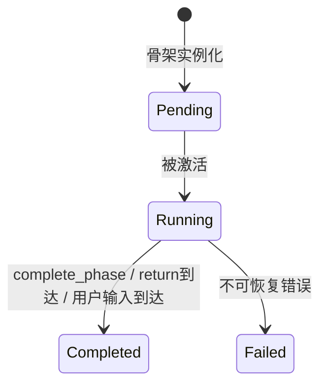
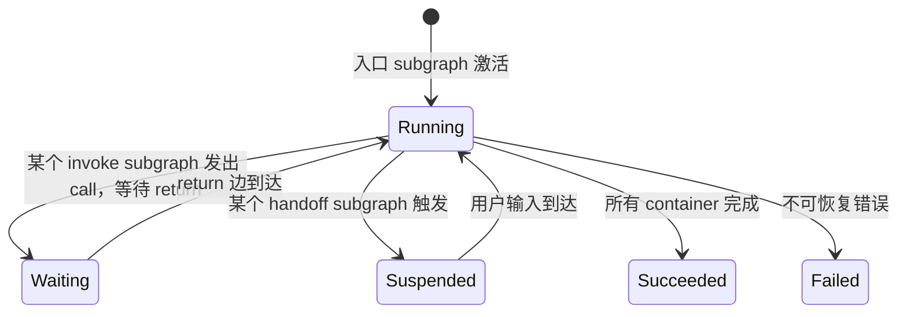
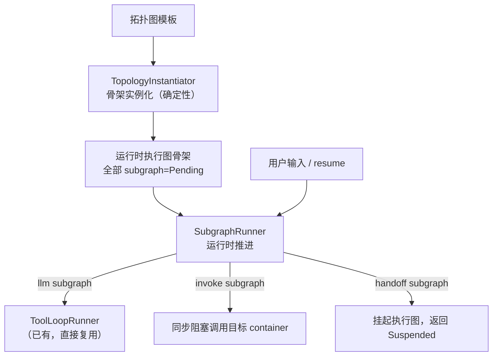

# 拓扑图到执行图的通用映射设计（v3）

## 问题描述

设计文档 `docs/Agent方案_updated.md` 定义了从**执行拓扑图（静态模板）**到**运行时执行图（动态轨迹）**的两阶段映射机制。核心设计约束是**通用性**：映射引擎不绑定任何具体 agent，拓扑图本身是提示词注入——同一套引擎驱动任意拓扑图。

**实施策略**：保留现有 `TopologyExecutionService` 不做改动（老模式），新建独立实现。前端 agent 界面提供手动切换：**"执行图模式"（新）** vs **"经典模式"（老）**。

---

## 两层状态机

> [!IMPORTANT]
> Subgraph 状态和 Graph 状态是两个独立的层级，职责严格分离。Graph 级状态从 Subgraph 状态**派生**，不由 SubgraphRunner 直接设置。

### Subgraph 级状态机（四态）



Subgraph 只关心自身的推进进度，不感知 graph 整体状态。

### Graph 级状态机（五态，派生）



推导规则：
- 任何 subgraph 因 `invoke` 等待 return → graph 进入 **Waiting**
- 任何 subgraph 因 `handoff` 挂起 → graph 进入 **Suspended**
- return 边到达 / 用户输入到达 → graph 恢复 **Running**
- 所有 container 的末尾 subgraph 均 Completed → graph **Succeeded**

---

## 架构分层



### 阶段一：`TopologyInstantiator`（骨架实例化）

纯数据变换，不涉及 LLM。输入拓扑图，输出全部 subgraph 为 Pending 的执行图。

1. 分配 `graph_id`，创建运行时执行图（status=Running）
2. 遍历拓扑 container → 创建运行时 container（继承 role_type、agent_type）
3. 遍历拓扑节点 → 创建运行时 subgraph（status=Pending），每个 subgraph 自动注入 start/end 节点对
4. 遍历边 → 创建运行时边（container 内 seq 边就绪，跨容器 call/return/retry 标记 Inactive）
5. 返回完整骨架

### 阶段二：`SubgraphRunner`（运行时推进）

以 subgraph 为单位驱动，agent 无关。

```python
class SubgraphRunner:
    """以 subgraph 为单位推进运行时执行图。"""
    
    def run(
        self, *, 
        skeleton: RuntimeGraphSkeleton,
        tool_executor: ToolExecutorProtocol,
        ai_proxy_client: Any,
        actor: str,
    ) -> ExecutionResult:
        """从入口 subgraph 开始全新执行。"""
    
    def resume(
        self, *,
        graph_id: str,
        user_input: dict[str, Any],
        tool_executor: ToolExecutorProtocol,
        ai_proxy_client: Any,
        actor: str,
    ) -> ExecutionResult:
        """从 Suspended 状态恢复执行。
        
        加载已有的执行图，定位挂起的 handoff subgraph，
        将 user_input 注入其上下文，标记 Completed，
        继续推进后续 subgraph。
        """
```

`run()` 和 `resume()` 共享同一套 subgraph 推进逻辑，区别仅在入口点：
- `run()`：从第一个 Pending subgraph 开始
- `resume()`：从挂起点的下一个 Pending subgraph 继续

### 推进逻辑（agent 无关）

```python
def _advance_subgraph(self, subgraph, container, scratchpad):
    """推进单个 subgraph。调用前 subgraph 已被标记为 Running。
    
    Returns:
        route_key: 条件路由字段（仅 llm 类型可能返回非 None）
    Raises:
        SuspendSignal: handoff 类型触发，subgraph 保持 Running
    """
    match subgraph.node_type:
        case "llm":
            # 构造上下文：task_prompt + scratchpad.format_for_prompt()
            # 启动 ToolLoopRunner，enable_complete_phase=True
            # ToolLoopRunner 内部循环直到 complete_phase 被调用
            # complete_phase 的 conclusion 自动追加到 Scratchpad
            result = tool_loop_runner.run(...)
            subgraph.status = "completed"
            return result.route_key
            
        case "invoke":
            # 从 start 节点读取 payload
            # 沿 call 边找到目标 container
            # 【同步阻塞】执行目标 container 的全部 subgraph
            # return 边的结论注入当前 subgraph 上下文
            conclusion = self._execute_container(target_container, payload)
            subgraph.status = "completed"
            return None
            
        case "handoff":
            # subgraph 保持 Running，不标记 Completed
            # graph 状态派生为 Suspended
            # resume() 被调用时才注入用户输入、标记 Completed、继续推进
            raise SuspendSignal(subgraph_id=subgraph.id)
```

### `resume()` 的恢复逻辑

```python
def resume(self, *, graph_id, user_input, ...):
    # 1. 加载执行图，找到状态为 Running 的 handoff subgraph（即挂起点）
    suspended_sg = find_subgraph(status="running", node_type="handoff")
    # 2. 将 user_input 注入该 subgraph 的上下文
    inject_user_input(suspended_sg, user_input)
    # 3. 标记该 subgraph 为 Completed
    suspended_sg.status = "completed"
    # 4. 解析后续 subgraph，继续推进
    next_sg = self._resolve_next_subgraph(suspended_sg, route_key=None, edges)
    return self._continue_from(next_sg, ...)
```

---

## 条件路由

`complete_phase` 工具已有显式的 `route_key` 参数（[tool_loop_runner.py L121-129](file:///w:/ruanchuang/code/Semantic-Atlas/backend_business/services/agent/execution/tool_loop_runner.py#L121-L129)），LLM 直接填写。路由匹配逻辑：

```python
def _resolve_next_subgraph(subgraph, route_key, edges):
    # 1. 如果拓扑节点有 conditional_edges 且 route_key 非空：
    #    逐一比对，激活第一条匹配的目标 subgraph
    # 2. 否则沿 seq 边无条件流转
    if subgraph.conditional_edges and route_key:
        for cond_edge in subgraph.conditional_edges:
            if cond_edge["condition"] == route_key:
                return find_subgraph(cond_edge["target_node_id"])
    # fallback: seq 边
    return find_next_seq_subgraph(subgraph)
```

---

## 上下文管理与 Scratchpad

现有 Scratchpad 实现已完整支持设计文档定义的三类写入（[scratchpad.py L71-100](file:///w:/ruanchuang/code/Semantic-Atlas/backend_business/services/agent/runtime/scratchpad.py#L71-L100)）：

| 写入类型 | entry_type | readonly | 触发方式 |
|---------|-----------|----------|---------|
| 模型自主备注 | `note` | `false` | LLM 调用 `scratchpad_write` |
| 工具结果只读摘录 | `tool_excerpt` | `true`（强制） | LLM 调用 `scratchpad_write(entry_type="tool_excerpt")` |
| 阶段结构化产出 | `stage_output` | `true` | 运行时在 `complete_phase` 成功后自动追加 |

每个 container 持有一个 Scratchpad 实例。subgraph 切换时，下游 subgraph 的 start 节点注入 `scratchpad.format_for_prompt()` 作为跨阶段上下文。

---

## 跨容器调用（第一期：串行执行）

> [!NOTE]
> 第一期只支持一个 invoke subgraph 调用单个 container 的场景，串行执行目标 container 的全部 subgraph，return 回来后继续。执行状态全部持久化在 DB，不存在线程阻塞问题。
>
> **异步的真实含义**：当一个 invoke 节点需要**同时**向多个 container 发起调用时（各 container 内部均有 LLM 调用），需要 `asyncio` 并发 await 多个 container 的执行，使多个 LLM API 调用同时进行，从而缩短整体响应延迟。这是第二期要解决的问题。

```
Container A (session_controller)           Container B (agent)
  ├── Subgraph[parse_intent, llm]
  ├── Subgraph[call_agent, invoke]         ├── Subgraph[analyze, llm]
  │     → 同步调用 Container B ──call──→   ├── Subgraph[review, llm]  
  │     ← 阻塞等待             ←─return── └── Subgraph[finalize, llm]
  └── Subgraph[reply_user, llm]
```

```python
def _execute_container(self, container, payload) -> str:
    """同步执行一个 container 的全部 subgraph 序列。
    
    Returns:
        末尾 subgraph 的 complete_phase conclusion（结构化结论）。
        这是 return 边回流给调用方的唯一内容。
        Scratchpad 是 container 内部的工作记忆，不对外暴露。
    """
    pad = Scratchpad()  # container 级，内部所有 subgraph 共享
    subgraphs = sorted(container.subgraphs, key=lambda s: s.order_index)
    last_conclusion: str = ""
    current_sg = subgraphs[0] if subgraphs else None
    
    while current_sg is not None:
        current_sg.status = "running"
        try:
            route_key = self._advance_subgraph(current_sg, container, pad)
            # _advance_subgraph 成功返回时已将 sg 标记为 completed
            last_conclusion = pad.last_stage_output()  # 最新的 complete_phase conclusion
        except SuspendSignal:
            # handoff 在 container 内部触发挂起，向上传播
            raise
        except Exception as exc:
            current_sg.status = "failed"
            # 决策：终止整个 graph（当前策略），或降级跳过
            raise ContainerExecutionError(
                container_id=container.id,
                subgraph_id=current_sg.id,
                cause=exc,
            ) from exc
        
        current_sg = self._resolve_next_subgraph(current_sg, route_key, edges)
    
    return last_conclusion  # return 边回流的结构化结论
```

**第二期**再做：单个 invoke 并发调用多个 container（多个 LLM 调用同时进行）、retry 边。

---

## 意图判断门控节点（Intent Judge）

> [!NOTE]
> 该节点**不属于拓扑图**，拓扑图仍然只有三个业务节点（`fetch_states`、`generate_pairs`、`semantic_verdict`）。意图判断节点是执行图层面的前置步骤，由代码手动记录到执行图中，不参与骨架实例化。

### 设计动机

冲突检测的三个 subgraph 代价较高（并行 ActorAsk 拉数据、LLM 生成候选对、LLM 逐对语义裁决）。用户的输入中存在与冲突检测无关的问题（如「什么是需求冲突？」「你好」），此时拉起完整拓扑图流程无意义且浪费资源。在拓扑图实例化之前增加一个轻量门控节点，通过一次简短 LLM 调用判断是否需要走冲突检测流程。

### 执行流程

```
用户消息到达
    ↓
执行图创建（status=Running）
    ↓
[intent_judge 节点]（手动记录，非拓扑节点）
  — 轻量 LLM 调用，判断 is_relevant: bool
  — 节点输出记录到执行图
    ↓
  is_relevant = false        is_relevant = true
    ↓                             ↓
直接 _stream_llm_reply      TopologyInstantiator 实例化拓扑图
（执行图 Succeeded）         → SubgraphRunner 推进三个 subgraph
```

### 实现规范

| 属性 | 值 |
|------|----|
| node_key | `intent_judge` |
| node_type | `llm` |
| role_type | `agent` |
| container_key | `conflict_detection_agent` |
| 是否在拓扑图中 | 否，由 `ConflictDetectionAgentService` 手动通过 `GraphRecorder` 记录 |
| 完成条件 | 一次 LLM 调用返回 `is_relevant` 判断即视为完成 |

**意图判断 prompt 示例：**

```
你是一个意图分类器。判断用户的消息是否属于"需求冲突检测"任务。

需求冲突检测任务的特征：
- 涉及具体的需求 ID（如 REQ-001）
- 要求检测、比对或分析需求之间的矛盾、冲突、不兼容
- 指定了检测范围（某个模块、某批需求）

不属于冲突检测的情况：
- 闲聊或问候
- 询问系统功能说明
- 无具体需求 ID 的泛泛提问

请只回复 JSON：{"is_relevant": true} 或 {"is_relevant": false}

用户消息：{user_message}
```

`is_relevant = false` 时，执行图以一次轻量 LLM 自然语言回复结束，不实例化拓扑图；`is_relevant = true` 时，继续正常的骨架实例化与 SubgraphRunner 推进流程。

---

## 分期实现计划

### 第一期（本轮实现）

覆盖范围：
- [x] 骨架实例化（`TopologyInstantiator`）
- [x] Subgraph 四态状态机（Pending/Running/Completed/Failed）
- [x] Graph 五态派生状态机
- [x] llm subgraph 推进（ToolLoopRunner + complete_phase）
- [x] handoff subgraph 挂起 + resume 恢复
- [x] invoke subgraph 同步阻塞跨容器调用
- [x] Scratchpad 跨阶段蒸馏（三类写入均已支持）
- [x] conditional_edges + route_key 条件路由
- [x] 前端模式切换（执行图模式 / 经典模式）
- [x] 意图判断门控节点（`intent_judge`，已集成到 `ConflictDetectionAgentService`）

### 第二期（后续）

- 单个 invoke 并发调用多个 container（asyncio 并发 await，多 LLM 调用同时进行）
- retry 边（带重试计数与约束变化记录）

---

## 实现文件规划

### 新增文件

| 文件 | 职责 |
|------|------|
| `services/agent/execution/topology_instantiator.py` | 骨架实例化器 |
| `services/agent/execution/subgraph_runner.py` | Subgraph 运行时推进引擎（含 run/resume） |
| `services/agent/execution/subgraph_state.py` | Subgraph 四态 + Graph 五态状态机定义 |
| `services/agent/execution/graph_executor.py` | 顶层编排：调用 Instantiator + Runner，对外暴露统一接口 |

### 修改文件

| 文件 | 变更 |
|------|------|
| [execution_schema.py](file:///w:/ruanchuang/code/Semantic-Atlas/backend_business/services/db_service_parts/schemas/execution_schema.py) | subgraph 表增加 `status` 字段 |
| 前端 agent 界面 | 增加执行模式选择（执行图模式 / 经典模式） |

### 保留不动

| 文件 | 说明 |
|------|------|
| [topology_execution_service.py](file:///w:/ruanchuang/code/Semantic-Atlas/backend_business/services/agent/execution/topology_execution_service.py) | 老模式，完整保留 |
| [tool_loop_runner.py](file:///w:/ruanchuang/code/Semantic-Atlas/backend_business/services/agent/execution/tool_loop_runner.py) | 直接复用，llm subgraph 的内部引擎 |
| [scratchpad.py](file:///w:/ruanchuang/code/Semantic-Atlas/backend_business/services/agent/runtime/scratchpad.py) | 直接复用，三类写入已完备 |
| Session 链（`session_id` / `prev_graph_id`） | 执行图已有现成实现，新引擎创建执行图时直接沿用，无需新增开发 |

---

## 通用性保证

| 维度 | 由谁提供 | 映射引擎是否知晓 |
|------|----------|------------------|
| 流程结构 | 拓扑图的边 | ❌ 只做机械匹配 |
| 阶段任务 | 拓扑节点的 `task_prompt` | ❌ 原样注入 LLM |
| 业务工具 | `ToolExecutor` 实例（外部传入） | ❌ 只负责调度 |
| 路由决策 | `conditional_edges` + `complete_phase.route_key` | ❌ 只做条件匹配 |
| 上下文蒸馏 | Scratchpad 按规则注入 | ❌ 不判断内容语义 |

映射引擎是一个**拓扑图解释器**：读取拓扑图，按确定性规则驱动 subgraph 推进，不对指令的业务语义做任何判断。任何 agent 的行为差异完全由拓扑图的 `task_prompt` 和外部传入的 `ToolExecutor` 决定。

---

## 验证计划

### 自动化测试

1. **骨架实例化**：验证 3 节点拓扑图 → 3 个 subgraph + 自动 start/end 节点
2. **Subgraph 状态流转**：Pending→Running→Completed 四态
3. **Graph 状态派生**：invoke 触发 Waiting、handoff 触发 Suspended
4. **条件路由**：`complete_phase(route_key="approved")` 匹配 `conditional_edges`
5. **Scratchpad 蒸馏**：上游 conclusion 自动追加、下游 start 节点读取
6. **Suspended 恢复**：`resume()` 从挂起点继续推进
7. **同步跨容器调用**：invoke → 同步执行目标 container → return 回流

```bash
python -m pytest tests/agent_chat/test_topology_execution_service.py -v  # 老模式不受影响
python -m pytest tests/agent_chat/test_graph_executor.py -v               # 新模式
```

### 手动验证
- 前端拓扑图编辑器创建的模板能被新引擎正确实例化
- 前端新增的"执行模式切换"按钮工作正常
- Traceability 视图正确展示按 subgraph 组织的执行轨迹
