# Semantic-Atlas 数据库设计文档

> **数据库**: PostgreSQL  
> **连接方式**: psycopg2 (同步)，通过 `POSTGRES_DSN` 环境变量配置  
> **Schema 管理**: 应用启动时自动执行 `CREATE TABLE IF NOT EXISTS` + `ALTER TABLE ADD COLUMN IF NOT EXISTS` 实现渐进式迁移

---

## 目录

1. [整体 ER 关系概览](#1-整体-er-关系概览)
2. [模块一：用户认证与权限](#2-模块一用户认证与权限)
3. [模块二：产品与项目管理](#3-模块二产品与项目管理)
4. [模块三：需求管理](#4-模块三需求管理)
5. [模块四：语音转写与采集](#5-模块四语音转写与采集)
6. [模块五：追溯分析与上下文](#6-模块五追溯分析与上下文)
7. [模块六：需求分析（L1-L4）](#7-模块六需求分析l1-l4)
8. [模块七：AI 对话与 Agent 通信](#8-模块七ai-对话与-agent-通信)
9. [模块八：执行拓扑图](#9-模块八执行拓扑图)
10. [模块九：需求 Actor（Event Sourcing）](#10-模块九需求-actorevent-sourcing)
11. [模块十：版本管理（里程碑/分支/合并）](#11-模块十版本管理里程碑分支合并)

---

## 1. 整体 ER 关系概览

```mermaid
erDiagram
    auth_users ||--o{ project_members : "加入项目"
    auth_users ||--o{ user_product_scopes : "产品授权"
    auth_users ||--o{ user_project_scopes : "项目授权"

    manage_products ||--o{ manage_projects : "包含"
    manage_products ||--o{ manage_product_members : "产品成员"

    manage_projects ||--o{ manage_requirements : "包含需求"
    manage_projects ||--o{ project_members : "项目成员"
    manage_projects ||--o{ execution_graphs : "关联拓扑"
    manage_projects ||--o{ ai_chat_sessions : "对话会话"
    manage_projects ||--o{ manage_test_cases : "测试用例"
    manage_projects ||--o{ manage_defects : "缺陷"
    manage_projects ||--o{ manage_milestones : "里程碑"
    manage_projects ||--o{ manage_branches : "分支"

    manage_requirements ||--o{ review_assignments : "评审"
    manage_requirements ||--o{ change_requests : "变更请求"
    manage_requirements ||--o{ manage_requirement_test_links : "关联测试"

    ai_chat_sessions ||--o{ ai_chat_messages : "消息"
    ai_chat_sessions ||--o{ requirement_change_approvals : "审批"

    agent_channels ||--o{ agent_channel_members : "成员"
    agent_channels ||--o{ agent_messages : "消息"

    execution_graphs ||--o{ execution_containers : "容器"
    execution_graphs ||--o{ execution_nodes : "节点"
    execution_graphs ||--o{ execution_edges : "边"
    execution_graphs ||--o{ execution_subgraphs : "子图"

    spans ||--o{ span_links : "关联"
    spans ||--o{ bundle_items : "打包"
    context_runs ||--o{ span_links : "包含"
    context_runs ||--o{ bundles : "包含"
    bundles ||--o{ bundle_items : "包含"
```

---

## 2. 模块一：用户认证与权限

### 2.1 auth_users — 用户认证表

| 字段 | 类型 | 约束 | 说明 |
|------|------|------|------|
| user_id | TEXT | PK | 用户唯一标识 |
| username | TEXT | UNIQUE, NOT NULL | 登录用户名 |
| password_hash | TEXT | NOT NULL | bcrypt 密码哈希 |
| display_name | TEXT | NOT NULL | 显示名称 |
| role | TEXT | NOT NULL, DEFAULT 'member' | 全局角色：`super_admin` / `admin` / `member` / `viewer` |
| is_active | BOOLEAN | NOT NULL, DEFAULT TRUE | 是否启用 |
| external_type | TEXT | CHECK IN ('CLIENT','CONTRACTOR') | 外部身份标识 |
| avatar_url | TEXT | — | 用户头像 URL |
| registration_status | TEXT | CHECK IN ('pending','approved','rejected') | 注册审批状态 |
| rejection_reason | TEXT | — | 拒绝原因 |
| approved_at | TIMESTAMPTZ | — | 批准时间 |
| approved_by | TEXT | — | 批准人 |
| rejected_at | TIMESTAMPTZ | — | 拒绝时间 |
| rejected_by | TEXT | — | 拒绝人 |
| created_at | TIMESTAMPTZ | NOT NULL, DEFAULT NOW() | 创建时间 |
| updated_at | TIMESTAMPTZ | NOT NULL, DEFAULT NOW() | 更新时间 |

**索引**: `username`, `role`, `registration_status`

### 2.2 project_members — 项目成员表

| 字段 | 类型 | 约束 | 说明 |
|------|------|------|------|
| id | BIGSERIAL | PK | 自增主键 |
| project_id | TEXT | FK → manage_projects, NOT NULL | 项目 ID |
| user_id | TEXT | FK → auth_users, NOT NULL | 用户 ID |
| joined_at | TIMESTAMPTZ | NOT NULL, DEFAULT NOW() | 加入时间 |

**唯一约束**: (project_id, user_id)

### 2.3 member_roles — 成员角色表

| 字段 | 类型 | 约束 | 说明 |
|------|------|------|------|
| id | BIGSERIAL | PK | 自增主键 |
| member_id | BIGINT | FK → project_members, NOT NULL | 成员 ID |
| role_id | TEXT | CHECK IN ('PO','BA','DEV','REVIEWER','QA','CONTRACTOR','CLIENT') | 项目角色 |
| granted_by | TEXT | FK → auth_users, NOT NULL | 授权人 |
| granted_at | TIMESTAMPTZ | NOT NULL, DEFAULT NOW() | 授权时间 |

**唯一约束**: (member_id, role_id)

### 2.4 user_product_scopes — 用户产品级授权

| 字段 | 类型 | 约束 | 说明 |
|------|------|------|------|
| id | BIGSERIAL | PK | 自增主键 |
| user_id | TEXT | FK → auth_users, NOT NULL | 用户 ID |
| product_id | TEXT | FK → manage_products, NOT NULL | 产品 ID |
| can_edit | BOOLEAN | NOT NULL, DEFAULT FALSE | 是否可编辑 |
| granted_by | TEXT | FK → auth_users, NOT NULL | 授权人 |
| granted_at | TIMESTAMPTZ | NOT NULL, DEFAULT NOW() | 授权时间 |
| updated_at | TIMESTAMPTZ | NOT NULL, DEFAULT NOW() | 更新时间 |

**唯一约束**: (user_id, product_id)

### 2.5 user_project_scopes — 用户项目级授权

结构与 `user_product_scopes` 相同，`product_id` 替换为 `project_id`（FK → manage_projects）。

---

## 3. 模块二：产品与项目管理

### 3.1 manage_products — 产品表

| 字段 | 类型 | 约束 | 说明 |
|------|------|------|------|
| product_id | TEXT | PK | 产品唯一标识 |
| name | TEXT | NOT NULL, UNIQUE | 产品名称 |
| description | TEXT | — | 产品描述 |
| status | TEXT | NOT NULL, DEFAULT 'active', CHECK IN ('active','archived') | 状态 |
| roadmap | TEXT | — | 产品路线图 |
| version | TEXT | — | 版本号 |
| tags | JSONB | — | 标签 |
| created_by | TEXT | — | 创建人 |
| created_at | TIMESTAMPTZ | NOT NULL, DEFAULT NOW() | 创建时间 |
| updated_at | TIMESTAMPTZ | NOT NULL, DEFAULT NOW() | 更新时间 |

### 3.2 manage_product_members — 产品成员表

| 字段 | 类型 | 约束 | 说明 |
|------|------|------|------|
| id | SERIAL | PK | 自增主键 |
| product_id | TEXT | FK → manage_products, NOT NULL | 产品 ID |
| user_id | TEXT | NOT NULL | 用户 ID |
| role | TEXT | NOT NULL, DEFAULT 'member', CHECK IN ('owner','admin','member','viewer') | 角色 |
| created_at | TIMESTAMPTZ | NOT NULL, DEFAULT NOW() | 创建时间 |
| updated_at | TIMESTAMPTZ | NOT NULL, DEFAULT NOW() | 更新时间 |

**唯一约束**: (product_id, user_id)

### 3.3 manage_projects — 项目表

| 字段 | 类型 | 约束 | 说明 |
|------|------|------|------|
| project_id | TEXT | PK | 项目唯一标识 |
| name | TEXT | NOT NULL, UNIQUE | 项目名称 |
| description | TEXT | — | 项目描述 |
| status | TEXT | NOT NULL, DEFAULT 'active', CHECK IN ('active','archived') | 状态 |
| product_id | TEXT | FK → manage_products | 所属产品 |
| current_session_id | TEXT | — | 当前关联的采集 session |
| created_by | TEXT | — | 创建人 |
| created_at | TIMESTAMPTZ | NOT NULL, DEFAULT NOW() | 创建时间 |
| updated_at | TIMESTAMPTZ | NOT NULL, DEFAULT NOW() | 更新时间 |

### 3.4 manage_audit_logs — 审计日志表

| 字段 | 类型 | 约束 | 说明 |
|------|------|------|------|
| log_id | TEXT | PK | 日志 ID |
| project_id | TEXT | — | 项目 ID |
| product_id | TEXT | — | 产品 ID |
| actor | TEXT | — | 操作人 |
| action | TEXT | — | 操作类型 |
| target_type | TEXT | — | 目标类型 |
| target_id | TEXT | — | 目标 ID |
| detail | JSONB | — | 详情 |
| created_at | TIMESTAMPTZ | NOT NULL, DEFAULT NOW() | 创建时间 |

---

## 4. 模块三：需求管理

### 4.1 manage_requirements — 需求表

| 字段 | 类型 | 约束 | 说明 |
|------|------|------|------|
| req_id | TEXT | PK | 需求唯一标识 |
| project_id | TEXT | FK → manage_projects, NOT NULL | 所属项目 |
| requirement_type | TEXT | NOT NULL, CHECK IN ('top_level','low_level','task') | 需求类型 |
| status | TEXT | NOT NULL, DEFAULT 'draft', CHECK IN ('draft','under_review','confirmed','in_progress','completed','archived') | 状态 |
| title | TEXT | NOT NULL | 标题 |
| description | TEXT | — | 描述 |
| priority | TEXT | — | 优先级（文本） |
| priority_suggested | INTEGER | CHECK 1-5 | AI 建议优先级 |
| priority_final | INTEGER | CHECK 1-5 | 最终优先级 |
| priority_decided_by | TEXT | — | 优先级决定人 |
| priority_decided_at | TIMESTAMPTZ | — | 优先级决定时间 |
| assignee | TEXT | — | 负责人 |
| parent_id | TEXT | FK → manage_requirements(req_id) | 父需求（树形结构） |
| order_index | INTEGER | NOT NULL, DEFAULT 0 | 排序索引 |
| source_req_id | TEXT | — | 来源需求 ID |
| source_level | TEXT | — | 来源层级 |
| tags | JSONB | — | 标签 |
| due_date | TEXT | — | 截止日期 |
| custom_fields | JSONB | — | 自定义字段 |
| baseline_id | BIGINT | FK → baselines(id) | 关联基线 |
| is_planned | BOOLEAN | NOT NULL, DEFAULT FALSE | 是否已规划 |
| deleted | BOOLEAN | NOT NULL, DEFAULT FALSE | 软删除标记 |
| current_version | INTEGER | DEFAULT 0 | Actor 当前版本 |
| last_event_id | TEXT | — | 最后事件 ID |
| last_snapshot_id | TEXT | — | 最后快照 ID |
| actor_status | TEXT | DEFAULT 'inactive' | Actor 状态 |
| created_by / updated_by | TEXT | — | 创建/更新人 |
| created_at / updated_at | TIMESTAMPTZ | NOT NULL, DEFAULT NOW() | 时间戳 |

**索引**: `project_id`, `parent_id`, `requirement_type`, `status`, `baseline_id`, `actor_status`

### 4.2 manage_test_cases — 测试用例表

| 字段 | 类型 | 约束 | 说明 |
|------|------|------|------|
| test_case_id | TEXT | PK | 测试用例 ID |
| project_id | TEXT | FK → manage_projects, NOT NULL | 所属项目 |
| title | TEXT | NOT NULL | 标题 |
| description | TEXT | — | 描述 |
| status | TEXT | NOT NULL, DEFAULT 'draft', CHECK IN ('draft','active','deprecated') | 状态 |
| source | TEXT | — | 来源 |
| created_by | TEXT | — | 创建人 |
| created_at | TIMESTAMPTZ | NOT NULL, DEFAULT NOW() | 创建时间 |

### 4.3 manage_requirement_test_links — 需求-测试用例关联表

| 字段 | 类型 | 约束 | 说明 |
|------|------|------|------|
| link_id | SERIAL | PK | 自增主键 |
| requirement_id | TEXT | FK → manage_requirements, NOT NULL | 需求 ID |
| test_case_id | TEXT | FK → manage_test_cases, NOT NULL | 测试用例 ID |
| link_type | TEXT | NOT NULL, DEFAULT 'verification' | 关联类型 |
| created_at | TIMESTAMPTZ | NOT NULL, DEFAULT NOW() | 创建时间 |

**唯一约束**: (requirement_id, test_case_id)

### 4.4 manage_defects — 缺陷表

| 字段 | 类型 | 约束 | 说明 |
|------|------|------|------|
| defect_id | TEXT | PK | 缺陷 ID |
| project_id | TEXT | FK → manage_projects, NOT NULL | 所属项目 |
| requirement_id | TEXT | FK → manage_requirements, NOT NULL | 关联需求 |
| title | TEXT | NOT NULL | 标题 |
| reproduce_steps | TEXT | NOT NULL, DEFAULT '' | 复现步骤 |
| severity | TEXT | NOT NULL, DEFAULT 'medium', CHECK IN ('critical','high','medium','low') | 严重程度 |
| priority | TEXT | NOT NULL, DEFAULT 'P2', CHECK IN ('P0','P1','P2','P3') | 优先级 |
| status | TEXT | NOT NULL, DEFAULT 'open', CHECK IN ('open','in_progress','resolved','verified','closed','rejected') | 状态 |
| reporter / dev_assignee / tester_assignee / current_assignee | TEXT | — | 相关人员 |
| created_by / updated_by | TEXT | — | 创建/更新人 |
| created_at / updated_at | TIMESTAMPTZ | NOT NULL, DEFAULT NOW() | 时间戳 |

### 4.5 review_assignments — 评审指派表

| 字段 | 类型 | 约束 | 说明 |
|------|------|------|------|
| id | BIGSERIAL | PK | 自增主键 |
| requirement_id | TEXT | FK → manage_requirements, NOT NULL | 需求 ID |
| reviewer_id | TEXT | FK → auth_users, NOT NULL | 评审人 |
| initiated_by | TEXT | FK → auth_users, NOT NULL | 发起人 |
| seq | SMALLINT | NOT NULL, DEFAULT 1 | 评审轮次 |
| status | TEXT | NOT NULL, DEFAULT 'PENDING', CHECK IN ('PENDING','APPROVED','REJECTED','WITHDRAWN') | 状态 |
| comment | TEXT | — | 评论 |
| decided_at | TIMESTAMPTZ | — | 决定时间 |
| created_at | TIMESTAMPTZ | NOT NULL, DEFAULT NOW() | 创建时间 |

### 4.6 baselines — 基线表

| 字段 | 类型 | 约束 | 说明 |
|------|------|------|------|
| id | BIGSERIAL | PK | 自增主键 |
| project_id | TEXT | FK → manage_projects, NOT NULL | 项目 ID |
| version | TEXT | NOT NULL, CHECK length ≥ 1 | 版本号 |
| locked | BOOLEAN | NOT NULL, DEFAULT FALSE | 是否锁定 |
| created_by | TEXT | FK → auth_users, NOT NULL | 创建人 |
| created_at | TIMESTAMPTZ | NOT NULL, DEFAULT NOW() | 创建时间 |

### 4.7 change_requests — 变更请求表

| 字段 | 类型 | 约束 | 说明 |
|------|------|------|------|
| id | BIGSERIAL | PK | 自增主键 |
| requirement_id | TEXT | FK → manage_requirements, NOT NULL | 需求 ID |
| baseline_id | BIGINT | FK → baselines, NOT NULL | 基线 ID |
| requested_by | TEXT | FK → auth_users, NOT NULL | 请求人 |
| reason | TEXT | NOT NULL | 变更原因 |
| change_summary | TEXT | NOT NULL | 变更摘要 |
| status | TEXT | NOT NULL, DEFAULT 'PENDING', CHECK IN ('PENDING','APPROVED','REJECTED') | 状态 |
| reviewed_by | TEXT | FK → auth_users | 审核人 |
| review_comment | TEXT | — | 审核意见 |
| created_at | TIMESTAMPTZ | NOT NULL, DEFAULT NOW() | 创建时间 |
| resolved_at | TIMESTAMPTZ | — | 解决时间 |

---

## 5. 模块四：语音转写与采集

### 5.1 transcription_sessions — 转写会话表

| 字段 | 类型 | 约束 | 说明 |
|------|------|------|------|
| session_id | TEXT | PK | 会话 ID |
| user_id | TEXT | NOT NULL | 用户 ID |
| status | TEXT | NOT NULL, DEFAULT 'queued', CHECK IN ('queued','running','succeeded','failed','timeout') | 状态 |
| source_filename | TEXT | NOT NULL | 源文件名 |
| source_extension | TEXT | NOT NULL | 文件扩展名 |
| source_content_type | TEXT | — | MIME 类型 |
| source_size_bytes | BIGINT | NOT NULL, DEFAULT 0 | 文件大小 |
| source_storage_path | TEXT | NOT NULL | 存储路径 |
| remote_request_id | TEXT | — | 远程请求 ID |
| transcript_text | TEXT | — | 转写全文 |
| transcript_segments | JSONB | — | 分段结果 |
| transcript_metadata | JSONB | — | 元数据 |
| error_code / error_message | TEXT | — | 错误信息 |
| attempt_count | INTEGER | NOT NULL, DEFAULT 0 | 重试次数 |
| started_at / completed_at | TIMESTAMPTZ | — | 开始/完成时间 |
| created_at / updated_at | TIMESTAMPTZ | NOT NULL, DEFAULT NOW() | 时间戳 |

### 5.2 transcription_attempts — 转写重试记录表

| 字段 | 类型 | 约束 | 说明 |
|------|------|------|------|
| id | SERIAL | PK | 自增主键 |
| session_id | TEXT | FK → transcription_sessions, NOT NULL | 会话 ID |
| attempt_no | INTEGER | NOT NULL | 重试序号 |
| status | TEXT | NOT NULL, CHECK IN ('running','succeeded','failed','timeout') | 状态 |
| remote_request_id | TEXT | — | 远程请求 ID |
| error_code / error_message | TEXT | — | 错误信息 |
| started_at | TIMESTAMPTZ | NOT NULL, DEFAULT NOW() | 开始时间 |
| completed_at | TIMESTAMPTZ | — | 完成时间 |
| metadata | JSONB | — | 元数据 |

**唯一约束**: (session_id, attempt_no)

---

## 6. 模块五：追溯分析与上下文

### 6.1 trace_analysis — 追溯分析记录表

| 字段 | 类型 | 约束 | 说明 |
|------|------|------|------|
| id | SERIAL | PK | 自增主键 |
| session_id | TEXT | — | 会话 ID |
| analysis_type | TEXT | NOT NULL | 分析类型: `relation` / `batch` |
| title | TEXT | NOT NULL | 标题 |
| description | TEXT | NOT NULL | 描述 |
| input_json | TEXT | NOT NULL | 输入 JSON |
| output_json | TEXT | NOT NULL | 输出 JSON |
| created_at | TIMESTAMPTZ | NOT NULL, DEFAULT NOW() | 创建时间 |

### 6.2 spans — 语音片段表

| 字段 | 类型 | 约束 | 说明 |
|------|------|------|------|
| span_id | TEXT | PK | 片段 ID |
| session_id | TEXT | NOT NULL | 会话 ID |
| start_ms / end_ms | INTEGER | — | 起止时间（毫秒） |
| speaker | TEXT | — | 说话人 |
| text | TEXT | NOT NULL | 文本内容 |
| asr_confidence | REAL | — | ASR 置信度 |
| meta_json | TEXT | — | 元数据 |
| created_at / updated_at | TIMESTAMPTZ | NOT NULL, DEFAULT NOW() | 时间戳 |

### 6.3 context_runs — 上下文运行记录表

| 字段 | 类型 | 约束 | 说明 |
|------|------|------|------|
| context_run_id | TEXT | PK | 运行 ID |
| session_id | TEXT | NOT NULL | 会话 ID |
| options_snapshot | JSONB | — | 运行参数快照 |
| status | TEXT | NOT NULL, DEFAULT 'RUNNING' | 运行状态 |
| stats | JSONB | — | 统计信息 |
| created_at | TIMESTAMPTZ | NOT NULL, DEFAULT NOW() | 创建时间 |

### 6.4 span_links — 片段关联矩阵表（稀疏边表）

| 字段 | 类型 | 约束 | 说明 |
|------|------|------|------|
| id | SERIAL | PK | 自增主键 |
| context_run_id | TEXT | FK → context_runs, NOT NULL | 运行 ID |
| source_span_id | TEXT | FK → spans, NOT NULL | 源片段 |
| target_span_id | TEXT | FK → spans, NOT NULL | 目标片段 |
| relation_type | TEXT | NOT NULL, CHECK IN ('continuation','elaboration','dependency','same_topic','conflict') | 关系类型 |
| strength | REAL | NOT NULL, CHECK 0~1 | 关联强度 |
| note | TEXT | — | 备注 |
| created_at | TIMESTAMPTZ | NOT NULL, DEFAULT NOW() | 创建时间 |

**唯一约束**: (context_run_id, source_span_id, target_span_id, relation_type)

### 6.5 bundles — 上下文包表

| 字段 | 类型 | 约束 | 说明 |
|------|------|------|------|
| bundle_id | TEXT | PK | 包 ID |
| context_run_id | TEXT | FK → context_runs | 运行 ID |
| session_id | TEXT | — | 会话 ID |
| order_index | INTEGER | — | 排序 |
| status | TEXT | DEFAULT 'READY' | 状态 |
| context_summary | TEXT | — | 上下文摘要 |
| meta | JSONB | — | 元数据 |
| created_at | TIMESTAMPTZ | NOT NULL, DEFAULT NOW() | 创建时间 |

### 6.6 bundle_items — 包内片段映射表

| 字段 | 类型 | 约束 | 说明 |
|------|------|------|------|
| id | SERIAL | PK | 自增主键 |
| bundle_id | TEXT | FK → bundles, NOT NULL | 包 ID |
| span_id | TEXT | FK → spans, NOT NULL | 片段 ID |
| span_ref | TEXT | NOT NULL | 片段引用 |
| order_index | INTEGER | NOT NULL | 排序 |

**唯一约束**: (bundle_id, span_ref), (bundle_id, span_id)

---

## 7. 模块六：需求分析（L1-L4）

### 7.1 requirements_l123 — 高层需求表（L1/L2/L3）

| 字段 | 类型 | 约束 | 说明 |
|------|------|------|------|
| req_id | TEXT | PK | 需求 ID |
| session_id | TEXT | NOT NULL | 采集会话 |
| level | TEXT | NOT NULL, CHECK IN ('L1','L2','L3') | 层级 |
| text | TEXT | NOT NULL, CHECK 10~500 字 | 需求文本 |
| fingerprint | TEXT | NOT NULL, UNIQUE | 去重指纹 |
| anchor_span_id | TEXT | FK → spans | 关联的语音片段 |
| r | INTEGER | — | 置信度/排序 |
| created_at | TIMESTAMPTZ | NOT NULL, DEFAULT NOW() | 创建时间 |

### 7.2 low_level_requirements — 底层需求表（L4）

| 字段 | 类型 | 约束 | 说明 |
|------|------|------|------|
| req_id | TEXT | PK | 需求 ID |
| session_id | TEXT | NOT NULL | 采集会话 |
| source_top_id | TEXT | — | 来源高层需求 |
| source_top_text | TEXT | — | 来源需求文本 |
| text | TEXT | NOT NULL | 需求描述 |
| component | TEXT | — | 组件 |
| acceptance_criteria | JSONB | — | 验收标准 |
| test_method | TEXT | — | 测试方法 |
| interfaces | JSONB | — | 接口定义 |
| data_contracts | JSONB | — | 数据契约 |
| error_handling | JSONB | — | 错误处理 |
| nfr | JSONB | — | 非功能性需求 |
| open_questions | JSONB | — | 待解决问题 |
| evidence_ids | JSONB | — | 证据链 |
| confidence | REAL | — | 置信度 |
| source | TEXT | — | 来源标识 |
| meta | JSONB | — | 元数据 |
| created_at | TIMESTAMPTZ | NOT NULL, DEFAULT NOW() | 创建时间 |

### 7.3 low_level_requirement_links — L4-上层需求多对多映射

| 字段 | 类型 | 约束 | 说明 |
|------|------|------|------|
| req_id | TEXT | FK → low_level_requirements, PK | L4 需求 ID |
| session_id | TEXT | NOT NULL | 会话 ID |
| top_req_id | TEXT | PK | 上层需求 ID |
| created_at | TIMESTAMPTZ | NOT NULL, DEFAULT NOW() | 创建时间 |

### 7.4 conflict_analysis — 冲突检测结果表

| 字段 | 类型 | 约束 | 说明 |
|------|------|------|------|
| id | SERIAL | PK | 自增主键 |
| batch_id | TEXT | — | 批次 ID |
| session_id | TEXT | — | 会话 ID |
| requirement_a / requirement_b | TEXT | NOT NULL | 冲突双方 |
| is_conflict | BOOLEAN | NOT NULL | 是否冲突 |
| raw_response | TEXT | — | 原始 AI 响应 |
| result_json | JSONB | — | 结构化结果 |
| created_at | TIMESTAMPTZ | NOT NULL, DEFAULT NOW() | 创建时间 |

### 7.5 classification_analysis — 需求分类结果表

| 字段 | 类型 | 约束 | 说明 |
|------|------|------|------|
| id | SERIAL | PK | 自增主键 |
| session_id | TEXT | — | 会话 ID |
| requirements | JSONB | NOT NULL | 需求集合 |
| predictions | JSONB | NOT NULL | 分类预测 |
| label_distribution | JSONB | — | 标签分布 |
| total | INTEGER | — | 总数 |
| result_json | JSONB | — | 完整结果 |
| created_at | TIMESTAMPTZ | NOT NULL, DEFAULT NOW() | 创建时间 |

---

## 8. 模块七：AI 对话与 Agent 通信

### 8.1 ai_chat_sessions — AI 对话会话表

| 字段 | 类型 | 约束 | 说明 |
|------|------|------|------|
| session_id | TEXT | PK | 会话 ID |
| project_id | TEXT | FK → manage_projects | 关联项目 |
| user_id | TEXT | NOT NULL | 用户 ID |
| title | TEXT | — | 会话标题 |
| active_graph_id | TEXT | — | 当前活跃拓扑图 |
| agent_type | TEXT | DEFAULT 'requirement_agent' | Agent 类型 |
| created_at / updated_at | TIMESTAMPTZ | NOT NULL, DEFAULT NOW() | 时间戳 |

### 8.2 ai_chat_messages — AI 对话消息表

| 字段 | 类型 | 约束 | 说明 |
|------|------|------|------|
| message_id | TEXT | PK | 消息 ID |
| session_id | TEXT | FK → ai_chat_sessions, NOT NULL | 会话 ID |
| user_id | TEXT | — | 用户 ID |
| role | TEXT | NOT NULL, CHECK IN ('user','assistant','system') | 角色 |
| content | TEXT | NOT NULL | 消息内容 |
| metadata | JSONB | — | 元数据 |
| is_read | BOOLEAN | NOT NULL, DEFAULT FALSE | 是否已读 |
| created_at | TIMESTAMPTZ | NOT NULL, DEFAULT NOW() | 创建时间 |

### 8.3 push_messages — 推送消息表

| 字段 | 类型 | 约束 | 说明 |
|------|------|------|------|
| message_id | TEXT | PK | 消息 ID |
| message_type | TEXT | NOT NULL, CHECK IN ('review','change') | 消息类型 |
| title | TEXT | NOT NULL | 标题 |
| content | TEXT | — | 内容 |
| source | TEXT | — | 来源 |
| priority | TEXT | DEFAULT 'medium', CHECK IN ('low','medium','high') | 优先级 |
| ai_suggestion | TEXT | — | AI 建议 |
| metadata | JSONB | — | 元数据 |
| read | BOOLEAN | NOT NULL, DEFAULT FALSE | 已读 |
| pushed | BOOLEAN | NOT NULL, DEFAULT FALSE | 已推送 |
| pushed_at | TIMESTAMPTZ | — | 推送时间 |
| created_at | TIMESTAMPTZ | NOT NULL, DEFAULT NOW() | 创建时间 |

### 8.4 requirement_change_approvals — 需求变更审批挂起表

| 字段 | 类型 | 约束 | 说明 |
|------|------|------|------|
| approval_request_id | TEXT | PK | 审批请求 ID |
| project_id | TEXT | FK → manage_projects | 项目 ID |
| session_id | TEXT | FK → ai_chat_sessions | 会话 ID |
| graph_id | TEXT | — | 拓扑图 ID |
| requirement_id | TEXT | NOT NULL | 需求 ID |
| requested_by | TEXT | NOT NULL | 请求人 |
| source_agent | TEXT | NOT NULL, DEFAULT 'requirement_agent' | 来源 Agent |
| approval_type | TEXT | NOT NULL, DEFAULT 'requirement_update' | 审批类型 |
| status | TEXT | NOT NULL, DEFAULT 'pending', CHECK IN ('pending','approved','rejected','applied') | 状态 |
| updates_json | JSONB | NOT NULL | 变更内容 |
| summary_text | TEXT | — | 摘要 |
| push_message_id | TEXT | FK → push_messages | 关联推送 |
| approved_by / rejected_by | TEXT | — | 审批人 |
| decision_comment | TEXT | — | 决定备注 |
| created_at | TIMESTAMPTZ | NOT NULL, DEFAULT NOW() | 创建时间 |
| resolved_at / applied_at | TIMESTAMPTZ | — | 解决/应用时间 |

### 8.5 mobile_chat_messages — 移动端对话桥接表

| 字段 | 类型 | 约束 | 说明 |
|------|------|------|------|
| message_id | TEXT | PK | 消息 ID |
| user_id | TEXT | NOT NULL, DEFAULT 'anonymous' | 用户 ID |
| session_id | TEXT | NOT NULL | 会话 ID |
| sender | TEXT | NOT NULL, CHECK IN ('web','mobile') | 发送端 |
| content | TEXT | NOT NULL | 消息内容 |
| metadata | JSONB | — | 元数据 |
| created_at | TIMESTAMPTZ | NOT NULL, DEFAULT NOW() | 创建时间 |

### 8.6 agent_channels — Agent 通信通道表

| 字段 | 类型 | 约束 | 说明 |
|------|------|------|------|
| channel_id | TEXT | PK | 通道 ID |
| channel_type | TEXT | NOT NULL, CHECK IN ('direct','group','broadcast') | 通道类型 |
| name | TEXT | — | 通道名称 |
| project_id | TEXT | FK → manage_projects | 关联项目 |
| created_by | TEXT | NOT NULL | 创建者 |
| created_at | TIMESTAMPTZ | DEFAULT NOW() | 创建时间 |
| is_archived | BOOLEAN | DEFAULT FALSE | 是否归档 |

### 8.7 agent_channel_members — 通道成员表

| 字段 | 类型 | 约束 | 说明 |
|------|------|------|------|
| channel_id | TEXT | FK → agent_channels, PK | 通道 ID |
| agent_id | TEXT | PK | Agent ID |
| role | TEXT | DEFAULT 'member' | 角色 |
| joined_at | TIMESTAMPTZ | DEFAULT NOW() | 加入时间 |

### 8.8 agent_messages — Agent 消息记录表

| 字段 | 类型 | 约束 | 说明 |
|------|------|------|------|
| message_id | TEXT | PK | 消息 ID |
| channel_id | TEXT | FK → agent_channels, NOT NULL | 通道 ID |
| sender_id | TEXT | NOT NULL | 发送者 |
| message_type | TEXT | NOT NULL, CHECK IN ('request','response','notify','vote','heartbeat','task_result') | 消息类型 |
| content | JSONB | — | 内容 |
| reply_to | TEXT | FK → agent_messages (自引用) | 回复目标 |
| metadata | JSONB | DEFAULT '{}' | 元数据 |
| created_at | TIMESTAMPTZ | DEFAULT NOW() | 创建时间 |

---

## 9. 模块八：执行拓扑图

### 9.1 execution_graphs — 执行拓扑图表

| 字段 | 类型 | 约束 | 说明 |
|------|------|------|------|
| graph_id | TEXT | PK | 拓扑图 ID |
| project_id | TEXT | FK → manage_projects, NOT NULL | 项目 ID |
| name | TEXT | NOT NULL | 名称 |
| description | TEXT | — | 描述 |
| graph_type | TEXT | NOT NULL, CHECK IN ('execution_topology_template','agent_runtime_execution') | 类型 |
| version | INTEGER | NOT NULL, DEFAULT 1 | 版本 |
| status | TEXT | NOT NULL, DEFAULT 'draft', CHECK IN ('draft','active','running','succeeded','failed','suspended') | 状态 |
| layout_json | JSONB | — | 布局 |
| meta_json | JSONB | — | 元数据 |
| is_deleted | BOOLEAN | NOT NULL, DEFAULT FALSE | 软删除 |
| created_by / updated_by | TEXT | — | 操作人 |
| created_at / updated_at | TIMESTAMPTZ | NOT NULL, DEFAULT NOW() | 时间戳 |

### 9.2 execution_containers — 执行容器表

| 字段 | 类型 | 约束 | 说明 |
|------|------|------|------|
| container_id | TEXT | PK | 容器 ID |
| graph_id | TEXT | FK → execution_graphs, NOT NULL | 拓扑图 ID |
| container_key | TEXT | NOT NULL | 容器标识 |
| label | TEXT | NOT NULL | 标签 |
| role_type | TEXT | NOT NULL, CHECK IN ('human','agent','system') | 角色类型 |
| config_json | JSONB | — | 配置 |
| order_index | INTEGER | NOT NULL, DEFAULT 0 | 排序 |
| is_deleted | BOOLEAN | NOT NULL, DEFAULT FALSE | 软删除 |

**唯一约束**: (graph_id, container_key)

### 9.3 execution_nodes — 执行节点表

| 字段 | 类型 | 约束 | 说明 |
|------|------|------|------|
| node_id | TEXT | PK | 节点 ID |
| graph_id | TEXT | FK → execution_graphs, NOT NULL | 拓扑图 ID |
| container_id | TEXT | FK → execution_containers | 所属容器 |
| subgraph_id | TEXT | FK → execution_subgraphs | 所属子图 |
| node_key | TEXT | NOT NULL | 节点标识 |
| label | TEXT | NOT NULL | 标签 |
| node_type | TEXT | NOT NULL, CHECK IN ('start','llm','handoff','invoke','end') | 节点类型 |
| role_type | TEXT | NOT NULL, CHECK IN ('human','agent','system') | 角色类型 |
| phase_label | TEXT | — | 阶段标签 |
| task_prompt | TEXT | — | 任务 Prompt |
| conditional_edges | JSONB | — | 条件边 |
| config_json | JSONB | — | 配置 |
| input_schema_json / output_schema_json | JSONB | — | IO Schema |
| order_index | INTEGER | NOT NULL, DEFAULT 0 | 排序 |
| is_deleted | BOOLEAN | NOT NULL, DEFAULT FALSE | 软删除 |

**唯一约束**: (graph_id, node_key)

### 9.4 execution_edges — 执行边表

| 字段 | 类型 | 约束 | 说明 |
|------|------|------|------|
| edge_id | TEXT | PK | 边 ID |
| graph_id | TEXT | FK → execution_graphs, NOT NULL | 拓扑图 ID |
| source_node_id | TEXT | FK → execution_nodes, NOT NULL | 源节点 |
| target_node_id | TEXT | FK → execution_nodes, NOT NULL | 目标节点 |
| edge_type | TEXT | NOT NULL, CHECK IN ('seq','call','return','retry') | 边类型 |
| label | TEXT | — | 标签 |
| condition_expr | TEXT | — | 条件表达式 |
| config_json | JSONB | — | 配置 |
| order_index | INTEGER | NOT NULL, DEFAULT 0 | 排序 |
| is_deleted | BOOLEAN | NOT NULL, DEFAULT FALSE | 软删除 |

**唯一约束**: (graph_id, source_node_id, target_node_id, edge_type)

### 9.5 execution_subgraphs — 执行子图表

| 字段 | 类型 | 约束 | 说明 |
|------|------|------|------|
| subgraph_id | TEXT | PK | 子图 ID |
| graph_id | TEXT | FK → execution_graphs, NOT NULL | 拓扑图 ID |
| container_id | TEXT | FK → execution_containers, NOT NULL | 所属容器 |
| subgraph_key | TEXT | NOT NULL | 子图标识 |
| label | TEXT | NOT NULL | 标签 |
| task_description | TEXT | NOT NULL, DEFAULT '' | 任务描述 |
| status | TEXT | NOT NULL, DEFAULT 'pending', CHECK IN ('pending','running','completed','failed') | 状态 |
| order_index | INTEGER | NOT NULL, DEFAULT 0 | 排序 |
| config_json | JSONB | — | 配置 |
| is_deleted | BOOLEAN | NOT NULL, DEFAULT FALSE | 软删除 |

**唯一约束**: (graph_id, subgraph_key)

---

## 10. 模块九：需求 Actor（Event Sourcing）

### 10.1 requirement_events — 需求事件存储表（仅追加）

| 字段 | 类型 | 约束 | 说明 |
|------|------|------|------|
| event_id | TEXT | PK | 事件 ID |
| requirement_id | TEXT | NOT NULL | 需求 ID |
| event_type | TEXT | NOT NULL, CHECK IN (7种事件类型) | 事件类型 |
| event_sequence | INTEGER | NOT NULL | 事件序列号 |
| event_data | JSONB | NOT NULL | 事件数据 |
| occurred_at | TIMESTAMPTZ | NOT NULL, DEFAULT NOW() | 发生时间 |
| source | TEXT | NOT NULL | 来源 |
| metadata | JSONB | DEFAULT '{}' | 元数据 |

**唯一约束**: (requirement_id, event_sequence)

**事件类型枚举**: `RequirementContentUpdated`, `RequirementStatusChanged`, `RequirementQualityMarkerAdded`, `RequirementEvidenceLinkAdded`, `RequirementPriorityChanged`, `RequirementCreated`, `RequirementDeleted`

### 10.2 requirement_snapshots — 需求快照表

| 字段 | 类型 | 约束 | 说明 |
|------|------|------|------|
| snapshot_id | TEXT | PK | 快照 ID |
| requirement_id | TEXT | NOT NULL | 需求 ID |
| version | INTEGER | NOT NULL | 版本号 |
| snapshot_data | JSONB | NOT NULL | 快照数据 |
| snapshot_reason | TEXT | CHECK IN ('scheduled','manual','passivation') | 快照原因 |
| created_at | TIMESTAMPTZ | NOT NULL, DEFAULT NOW() | 创建时间 |
| event_count | INTEGER | DEFAULT 0 | 事件计数 |

### 10.3 requirement_command_queue — 命令队列审计表

| 字段 | 类型 | 约束 | 说明 |
|------|------|------|------|
| queue_id | TEXT | PK | 队列 ID |
| requirement_id | TEXT | NOT NULL | 需求 ID |
| command_type | TEXT | NOT NULL | 命令类型 |
| command_data | JSONB | NOT NULL | 命令数据 |
| submitted_by | TEXT | NOT NULL | 提交人 |
| status | TEXT | NOT NULL, DEFAULT 'pending' | 状态 |
| submitted_at | TIMESTAMPTZ | NOT NULL, DEFAULT NOW() | 提交时间 |
| started_at / completed_at | TIMESTAMPTZ | — | 开始/完成时间 |
| error_message | TEXT | — | 错误消息 |
| priority | INTEGER | DEFAULT 0 | 优先级 |

---

## 11. 模块十：版本管理（里程碑/分支/合并）

### 11.1 manage_milestones — 里程碑表

| 字段 | 类型 | 约束 | 说明 |
|------|------|------|------|
| milestone_id | TEXT | PK | 里程碑 ID |
| project_id | TEXT | FK → manage_projects, NOT NULL | 项目 ID |
| name | TEXT | NOT NULL | 名称 |
| description / message | TEXT | — | 描述/消息 |
| milestone_type | TEXT | NOT NULL, DEFAULT 'regular', CHECK IN ('regular','baseline','branch','merge') | 类型 |
| is_baseline | BOOLEAN | NOT NULL, DEFAULT FALSE | 是否基线 |
| sprint / version | TEXT | — | 冲刺/版本 |
| tags | JSONB | — | 标签 |
| created_by | TEXT | — | 创建人 |
| created_at | TIMESTAMPTZ | NOT NULL, DEFAULT NOW() | 创建时间 |
| metadata | JSONB | — | 元数据 |

### 11.2 manage_milestone_nodes — 里程碑节点快照表

记录里程碑时刻的需求快照。

### 11.3 manage_milestone_relations — 里程碑内节点关系表

记录里程碑中需求的父子关系。

### 11.4 manage_milestone_edges — 里程碑连线表

记录里程碑之间的边关系（如演化、分支、合并）。

### 11.5 manage_branches — 分支表

| 字段 | 类型 | 约束 | 说明 |
|------|------|------|------|
| branch_id | TEXT | PK | 分支 ID |
| project_id | TEXT | FK → manage_projects, NOT NULL | 项目 ID |
| base_milestone_id | TEXT | FK → manage_milestones, NOT NULL | 基础里程碑 |
| name | TEXT | NOT NULL | 分支名称 |
| status | TEXT | NOT NULL, DEFAULT 'active', CHECK IN ('active','under_review','merged','closed') | 状态 |
| created_by | TEXT | — | 创建人 |
| metadata | JSONB | — | 元数据 |

### 11.6 manage_branch_refs — 分支引用表

记录分支/标签指向的里程碑快照。

### 11.7 manage_change_sets — 变更集表

记录分支中每一项需求变更的 before/after diff。

### 11.8 manage_impact_reports — 影响分析报告表

记录分支变更的影响分析结果。

### 11.9 manage_merge_logs — 合并日志表

记录分支合并操作的过程与结果。

### 11.10 manage_reviews — 评审表

记录分支级别的 code-review 式审批。

---

## 附录：Schema 文件索引

| Schema 文件 | 对应模块 |
|---|---|
| `project_schema.py` | 产品、项目、需求、测试、缺陷、里程碑、分支、审计 |
| `auth_user_schema.py` | 用户认证、权限、成员、角色、评审、基线、变更请求 |
| `agent_chat_schema.py` | AI 对话、推送消息、审批挂起、移动端桥接、Agent 通信 |
| `requirement_schema.py` | L1-L4 需求、冲突检测、分类分析 |
| `trace_schema.py` | 追溯分析、spans、上下文包 |
| `transcription_schema.py` | 语音转写会话与重试 |
| `execution_schema.py` | 执行拓扑图（图、容器、节点、边、子图） |
| `requirement_actor_schema.py` | Event Sourcing 事件/快照/命令队列 |
