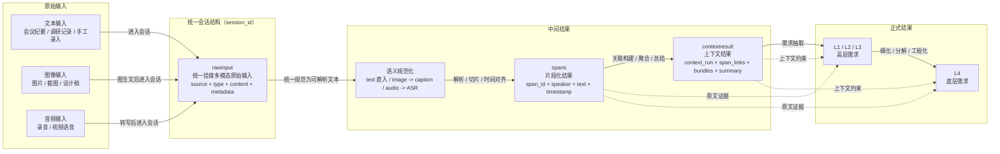

# 需求获取模块数据流转图

本文将需求获取模块统一表述为“原始输入 -> 中间结果 -> 正式结果”的演化过程，重点描述 `rawinput`、`spans`、`contextresult`、`L1/L2/L3` 和 `L4` 之间的数据传递关系。

## 数据流转图

## 演化关系说明

| 阶段 | 核心对象 | 含义 | 在当前仓库中的落点 |
| --- | --- | --- | --- |
| 原始输入 | `rawinput` | 会话级原始输入容器，负责统一承接文本、图像、音频来源 | 这是图中的统一抽象；当前代码中由 `session_id` 关联文本入库、图像预览、ASR 会话等来源 |
| 中间结果 1 | `spans` | 将输入规范化为可追踪的语义片段，是后续上下文构建和需求抽取的共同基础 | `spans` 表，解析逻辑位于 `backend_business/services/transcript_parser.py` |
| 中间结果 2 | `contextresult` | 基于 `spans` 构建出的上下文关联结果，强调片段之间的关系、聚合和摘要 | `context_runs`、`span_links`、`bundles` |
| 正式结果 1 | `L1/L2/L3` | 从上下文结果中抽取出的高层需求 | `requirements_l123` |
| 正式结果 2 | `L4` | 由高层需求进一步细化形成的底层需求 | `low_level_requirements` |

## 与实际接口的映射

- 文本输入：`/api/v2/analysis/ingest_transcript`，文本直接进入会话并被解析为 `spans`
- 图像输入：`/api/v2/vision/caption` 先生成 `caption / transcript_text`，再通过 `/api/v2/vision/previews/{preview_id}/confirm` 写入 `spans`
- 音频输入：`/api/v2/asr/sessions` 先生成 `transcript_text`，再作为后续解析与需求提取的文本来源
- 上下文构建：`/api/v2/analysis/build_context`，由 `spans` 生成 `contextresult`
- 高层需求抽取：`/api/v2/requirements/extract_l123`
- 底层需求生成：`/api/v2/requirements/l4/generate`

## 适合汇报时使用的一句话说明

需求获取模块先将文本、图像和音频统一归并为会话级 `rawinput`，再规范化为 `spans`，进一步生成 `contextresult`，最终沉淀为高层需求 `L1/L2/L3` 和底层需求 `L4`，完整体现了“原始输入 -> 中间结果 -> 正式结果”的逐层演化过程。
